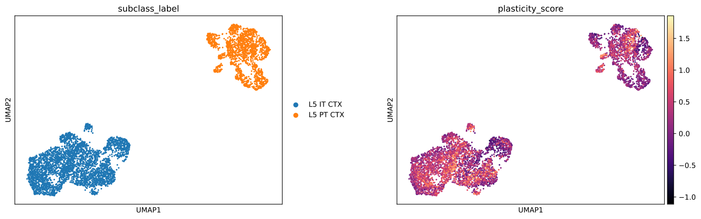
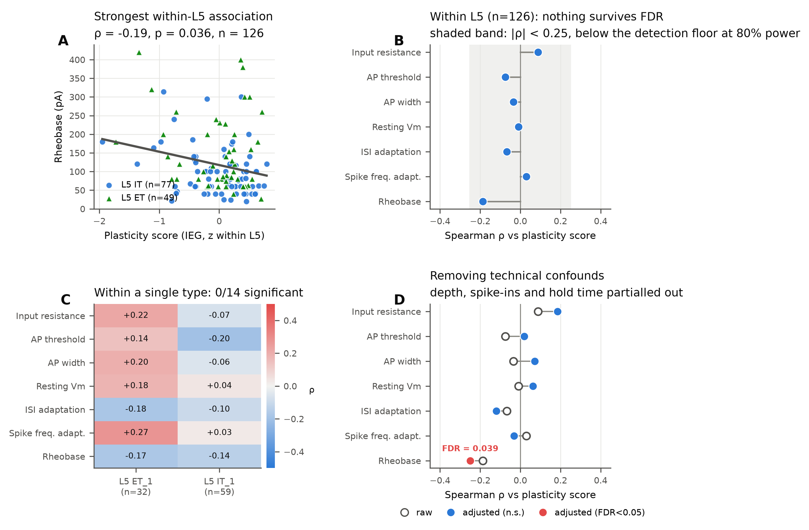
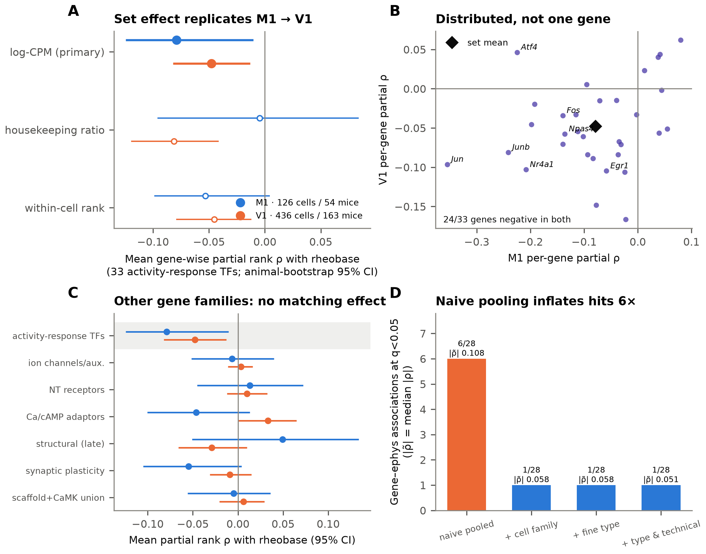

# Disentangling cell type from activity state in mouse cortex

Code and results for the Kavli Foundation NeuroData Discovery Award LS-2025-GR-0076-3185, *"Disentangling Cell
Type from State in Motor Cortex"* (PI Peter Hogg, laboratory of Adam Cohen, Harvard University). All analyses use
public data.

**Question.** Single-cell RNA-seq splits cortical neurons into dozens of transcriptomic types. Are some of them
transient activity states rather than identities? And does an immediate-early-gene (IEG) "plasticity score" explain
why neurons of the same type differ in intrinsic physiology?

**Answer.**
1. **Activity state is an axis orthogonal to cell type.** IEG programmes vary *within* every transcriptomic
   cluster: 59–75% of their variance lies within clusters in the Allen atlas (z = +13.7 against matched genes). They
   do not define clusters.
2. **Within a type, activity state does not predict how neurons fire.** This held across 12–29 intrinsic features,
   six pyramidal populations and 28 clusters, and in an independent test of 888 V1 interneurons.
3. **One small effect replicates.** A fixed 33-gene activity-response set tracks slightly lower rheobase in M1
   (−0.079, 95% CI −0.124 to −0.010) and in independent V1 data (−0.048, −0.082 to −0.013), but no single gene does.
4. **Naive analysis misleads.** Pooling across cell types inflates gene–physiology "hits" about six-fold, and tissue
   preparation reshapes IEG levels.

| Activity state is orthogonal to type | It does not predict firing within type | The one replicated (small) effect |
|---|---|---|
|  |  |  |

## Layout
Analyses are grouped by the dataset they use. Each folder under `analysis/` has `scripts/`, `results/`,
`figures/` and, where needed, `data/` (derived caches, mostly git-ignored).

```
analysis/
  m1_patchseq/         Mouse M1 Patch-seq (Scala et al. 2021): IEG scores, within-type ephys tests, notebooks
  allen_atlas/         Allen SMART-seq atlas and MOp cells vs nuclei: within-cluster spread, dissociation control
  v1_patchseq/         Mouse V1 Patch-seq: L5 ET quantification and set test; interneuron ephys extraction and test
  macaque_patchseq/    Macaque Patch-seq (Dembrow et al.): cross-species test, acute vs cultured preparation
  ibl_neuropixels/     IBL Brain-Wide Map: in vivo unit firing statistics, trait vs state
  cross_dataset/       Analyses that combine datasets, including
    preregistrations/    Frozen confirmatory-analysis plans and integrity records
    m1_v1_validation/    harmonised, animal-aware M1 -> V1 activity-response set test
    ephys_spread/        ephys-linked genes vs within-cluster RNA spread
  common/              Shared paths, loaders, gene sets and plotting styles
data/fetch_data.py     Downloads the core public inputs
third_party/           Allen Institute ephys feature extractor (its own licence, see NOTICE)
run_all.sh             Runs every analysis in dependency order
```

Scripts keep their original numbers, which give the run order within each of the two series in `run_all.sh`
(gene-level tests `01`–`39`; whole-dataset AnnData analyses `01_build_patchseq` onward). Scripts reuse each other's
functions by module name; `analysis/common/paths.py` makes that work from any folder.

## Scripts

<details><summary><b>Mouse M1 Patch-seq</b> — <code>analysis/m1_patchseq/</code> (27 scripts)</summary>

| Script | What it does |
|---|---|
| [`scripts/01_build_patchseq.py`](analysis/m1_patchseq/scripts/01_build_patchseq.py) | Assemble the M1 Patch-seq dataset (Scala et al. 2021, GSE163764) into one AnnData. |
| [`scripts/01_l5_plasticity_ephys.py`](analysis/m1_patchseq/scripts/01_l5_plasticity_ephys.py) | Does activity state predict intrinsic ephys *within* type? |
| [`scripts/02_figures_ephys_confound.py`](analysis/m1_patchseq/scripts/02_figures_ephys_confound.py) | Build the two Patch-seq figures from the tables written by 01. |
| [`scripts/02_patchseq_type_vs_state.py`](analysis/m1_patchseq/scripts/02_patchseq_type_vs_state.py) | Is IEG ('plasticity') expression a cell-type property or a cell-state property in M1 Patch-seq, and does it explain intrinsic electrophysiology beyond t-type? |
| [`scripts/02b_ieg_coherence.py`](analysis/m1_patchseq/scripts/02b_ieg_coherence.py) | Is the within-t-type IEG variance a coherent program (a real state) or technical noise? |
| [`scripts/03_gene_level_rheobase.py`](analysis/m1_patchseq/scripts/03_gene_level_rheobase.py) | Genome-wide gene-vs-rheobase screen in L5 excitatory cells, plus the co-expression module around the hits. |
| [`scripts/03b_module_is_it_subtype.py`](analysis/m1_patchseq/scripts/03b_module_is_it_subtype.py) | Is the rheobase-correlated gene module a plasticity signal, or IT-vs-ET subtype identity in disguise? |
| [`scripts/04_ephys_wide_screen.py`](analysis/m1_patchseq/scripts/04_ephys_wide_screen.py) | Does ANY non-ion-channel gene relate to intrinsic electrophysiology? |
| [`scripts/04_joint_embedding.py`](analysis/m1_patchseq/scripts/04_joint_embedding.py) | Joint transcriptome-electrophysiology latent space within Patch-seq. |
| [`scripts/05_glutamatergic_within_type.py`](analysis/m1_patchseq/scripts/05_glutamatergic_within_type.py) | Pool all glutamatergic cells for power, but estimate WITHIN type. |
| [`scripts/06_l5_ieg_index.py`](analysis/m1_patchseq/scripts/06_l5_ieg_index.py) | Layer-focused (L5 by default; `--layer 23` for L2/3): does an expression-based IEG index predict the intrinsic properties of layer-5 pyramidal neurons? |
| [`scripts/06_per_pyramidal_class.py`](analysis/m1_patchseq/scripts/06_per_pyramidal_class.py) | Stratify by pyramidal (glutamatergic) class: is any effect class-specific? |
| [`scripts/06b_l5_it_robustness.py`](analysis/m1_patchseq/scripts/06b_l5_it_robustness.py) | Stress-test the L5 IT candidate (rapid-IEG index vs rheobase / sag) from 06. |
| [`scripts/06c_cross_layer_check.py`](analysis/m1_patchseq/scripts/06c_cross_layer_check.py) | Cross-layer check of the nominal L2/3 IT signal (rapid-IEG index vs resting potential and membrane time constant): permutation null, stress-score and covariate adjustment, and the same model in… |
| [`scripts/07_per_cluster_slopes.py`](analysis/m1_patchseq/scripts/07_per_cluster_slopes.py) | Per-cluster IEG -> ephys slopes in M1 Patch-seq. |
| [`scripts/07b_pvalb_check.py`](analysis/m1_patchseq/scripts/07b_pvalb_check.py) | Stress-test the Pvalb Il1rapl2 per-cluster hit (IEG vs max APs / AP width) from 07. Output: results/cluster_hit_robustness.csv |
| [`scripts/07c_redraw_fig7.py`](analysis/m1_patchseq/scripts/07c_redraw_fig7.py) | Redraw figure 7 from saved results of 07_per_cluster_slopes.py (no re-permutation). |
| [`scripts/17_bidirectional_test.py`](analysis/m1_patchseq/scripts/17_bidirectional_test.py) | Bidirectional plasticity: test magnitude, not direction. |
| [`scripts/20_layer_meta_analysis.py`](analysis/m1_patchseq/scripts/20_layer_meta_analysis.py) | Pool pyramidal cells across layers WITHOUT assuming a common slope. |
| [`scripts/22_fig5_l5_pyramidal.py`](analysis/m1_patchseq/scripts/22_fig5_l5_pyramidal.py) | Figure 5: L5 pyramidal focus — IEG index vs intrinsic properties (from 06 / 06b). |
| [`scripts/23_fig6_cross_layer.py`](analysis/m1_patchseq/scripts/23_fig6_cross_layer.py) | Figure 6: IEG index vs intrinsic properties across pyramidal-cell populations (L2/3 IT, L4/5 IT, L5 IT, L5 ET, L6 IT, L6 CT), one identical model per group. |
| [`scripts/23_functional_categories_by_layer.py`](analysis/m1_patchseq/scripts/23_functional_categories_by_layer.py) | Seven functional gene categories, tested as SETS, layer by layer. |
| [`scripts/24_which_ephys_metric.py`](analysis/m1_patchseq/scripts/24_which_ephys_metric.py) | Which ephys feature best tracks activity state? Not just rheobase. |
| [`scripts/27_composition_artifact_test.py`](analysis/m1_patchseq/scripts/27_composition_artifact_test.py) | Is the Jarid2/Gphn axis a library-composition artifact? |
| [`scripts/32_index_all_features_M1.py`](analysis/m1_patchseq/scripts/32_index_all_features_M1.py) | What else does the IEG index predict in mouse M1? |
| [`scripts/34_normalisation_comparison.py`](analysis/m1_patchseq/scripts/34_normalisation_comparison.py) | Does housekeeping normalisation fix the composition confound? |
| [`scripts/35_hknorm_panels_all_features.py`](analysis/m1_patchseq/scripts/35_hknorm_panels_all_features.py) | With housekeeping normalisation, does any panel predict any ephys feature? |

</details>

<details><summary><b>Allen atlas</b> — <code>analysis/allen_atlas/</code> (7 scripts)</summary>

| Script | What it does |
|---|---|
| [`scripts/03_allen_cells_vs_nuclei.py`](analysis/allen_atlas/scripts/03_allen_cells_vs_nuclei.py) | Ex vivo induction control: Allen MOp SMART-seq dissociated cells vs. nuclei. |
| [`scripts/11_atlas_extract_panels.py`](analysis/allen_atlas/scripts/11_atlas_extract_panels.py) | Extract activity-gene panels from the Allen SmartSeq atlas (Tasic et al. 2018). |
| [`scripts/12_figure1_atlas.py`](analysis/allen_atlas/scripts/12_figure1_atlas.py) | Plot activity-gene panel scores across glutamatergic cells of the Allen SmartSeq atlas. |
| [`scripts/14_within_cluster_spread.py`](analysis/allen_atlas/scripts/14_within_cluster_spread.py) | Within-cluster spread of activity-gene panel scores in the Allen SmartSeq atlas. |
| [`scripts/15_state_axis_function.py`](analysis/allen_atlas/scripts/15_state_axis_function.py) | Gene-set enrichment along the within-cluster activity-state axis (Allen SmartSeq atlas). |
| [`scripts/33_ltp_index_spread.py`](analysis/allen_atlas/scripts/33_ltp_index_spread.py) | Within-cluster spread of an LTP gene index in the Allen SmartSeq atlas. |
| [`scripts/39_asd_atlas_patterns.py`](analysis/allen_atlas/scripts/39_asd_atlas_patterns.py) | SFARI ASD risk genes in the Allen SmartSeq atlas: type-specificity and within-cluster spread. |

</details>

<details><summary><b>Mouse V1 Patch-seq</b> — <code>analysis/v1_patchseq/</code> (5 scripts)</summary>

| Script | What it does |
|---|---|
| [`scripts/09_v1_extract_ephys.py`](analysis/v1_patchseq/scripts/09_v1_extract_ephys.py) | Download V1 Patch-seq NWBs (DANDI:000020; Gouwens et al. 2020) and extract intrinsic features per cell. No expression / IEG data is read here (only the ephys_session_id / cell_specimen_id /… |
| [`scripts/09_v1_extract_probe.py`](analysis/v1_patchseq/scripts/09_v1_extract_probe.py) | Proof of concept: extract rheobase from one DANDI:001455 NWB. |
| [`scripts/10_v1_pvalb_test.py`](analysis/v1_patchseq/scripts/10_v1_pvalb_test.py) | Test whether IEG_rapid predicts excitability in V1 Pvalb Patch-seq cells assigned to M1 Pvalb t-types. |
| [`scripts/10_v1_quantify_l5et.py`](analysis/v1_patchseq/scripts/10_v1_quantify_l5et.py) | Quantify mouse V1 L5 ET Patch-seq transcriptomes (Sorensen et al. 2026). |
| [`scripts/28_v1_confirmatory.py`](analysis/v1_patchseq/scripts/28_v1_confirmatory.py) | Test IEG and ASD-gene associations with rheobase in mouse V1 L5 ET cells (Sorensen et al. 2026). |

</details>

<details><summary><b>Macaque Patch-seq</b> — <code>analysis/macaque_patchseq/</code> (2 scripts)</summary>

| Script | What it does |
|---|---|
| [`scripts/07_dembrow_confirmatory.py`](analysis/macaque_patchseq/scripts/07_dembrow_confirmatory.py) | Test IEG associations with rheobase in macaque L5 Patch-seq cells (Dembrow et al. 2024). |
| [`scripts/08_dembrow_prep_diagnostic.py`](analysis/macaque_patchseq/scripts/08_dembrow_prep_diagnostic.py) | Acute vs cultured preparation diagnostic for macaque L5 ET cells (Dembrow et al. 2024). |

</details>

<details><summary><b>IBL Neuropixels</b> — <code>analysis/ibl_neuropixels/</code> (2 scripts)</summary>

| Script | What it does |
|---|---|
| [`scripts/05_ibl_trait_vs_state.py`](analysis/ibl_neuropixels/scripts/05_ibl_trait_vs_state.py) | In vivo firing statistics of motor-cortex units (IBL Brain-Wide Map, DANDI:000409). |
| [`scripts/ibl_extract_units.py`](analysis/ibl_neuropixels/scripts/ibl_extract_units.py) | Extract per-unit in-vivo firing statistics for motor-cortex (and comparison isocortex) units from the IBL Brain-Wide Map on DANDI (dandiset 000409). |

</details>

<details><summary><b>Cross-dataset</b> — <code>analysis/cross_dataset/</code> (22 scripts)</summary>

| Script | What it does |
|---|---|
| [`scripts/08_v1_label_transfer.py`](analysis/cross_dataset/scripts/08_v1_label_transfer.py) | Label transfer of M1 Pvalb t-types to V1 Pvalb cells (outcome-blind; no V1 ephys is read here). |
| [`scripts/13_figure2_exvivo.py`](analysis/cross_dataset/scripts/13_figure2_exvivo.py) | Figure 2: IEG expression versus ex vivo time in mouse M1 and macaque Patch-seq. |
| [`scripts/16_two_stage_candidate_test.py`](analysis/cross_dataset/scripts/16_two_stage_candidate_test.py) | Two-stage design: select candidates outcome-blind, then test in Patch-seq. |
| [`scripts/18_l5pt_targeted_candidates.py`](analysis/cross_dataset/scripts/18_l5pt_targeted_candidates.py) | Cluster-targeted stage 1: nominate candidates from the L5 PT (=ET) subclass. |
| [`scripts/19_setlevel_crossclass.py`](analysis/cross_dataset/scripts/19_setlevel_crossclass.py) | Set-level test across cell classes, with GABAergic cells as control. |
| [`scripts/20_figs1-3_type_vs_state.py`](analysis/cross_dataset/scripts/20_figs1-3_type_vs_state.py) | Figures 1-3: transcriptomic type vs IEG state (Patch-seq + Allen control) and ephys. SVG with editable text + 300-dpi PNG. |
| [`scripts/21_breakdown_and_genomewide_pool.py`](analysis/cross_dataset/scripts/21_breakdown_and_genomewide_pool.py) | Patch-seq cell-type census, and a genome-wide layer-pooled candidate screen. |
| [`scripts/21_fig4_in_vivo_context.py`](analysis/cross_dataset/scripts/21_fig4_in_vivo_context.py) | Figure 4: in vivo trait vs state (IBL) and the Patch-seq-derived prediction. Also writes results/aim2_patchseq_tercile_prediction.csv (high- vs low-IEG cells, within type). |
| [`scripts/22_repairs_excitatory.py`](analysis/cross_dataset/scripts/22_repairs_excitatory.py) | Two robustness checks on excitatory set-level and variance-coupling tests. |
| [`scripts/24_fig0_headline_replication.py`](analysis/cross_dataset/scripts/24_fig0_headline_replication.py) | Figure 0: the M1 -> V1 activity-response gene-set effect on rheobase, drawn from the m1_v1_validation tables (read-only; no values recomputed). Output: figures/fig0_replicated_set_effect.{svg,png} |
| [`scripts/25_layer_specificity_test.py`](analysis/cross_dataset/scripts/25_layer_specificity_test.py) | Tests of layer specificity, one per dataset. |
| [`scripts/26_characterise_candidates.py`](analysis/cross_dataset/scripts/26_characterise_candidates.py) | Characterise Jarid2 and Gphn: activity-state predictor, or type/size marker? |
| [`scripts/29_figure5_replication.py`](analysis/cross_dataset/scripts/29_figure5_replication.py) | Figure 5: M1 -> V1 replication of the IEG_TF gene-set effect on rheobase, set vs single gene. |
| [`scripts/30_index_vs_set_exploratory.py`](analysis/cross_dataset/scripts/30_index_vs_set_exploratory.py) | EXPLORATORY — IEG index vs gene-set statistic, and which genes carry the set effect. |
| [`scripts/31_ieg_independent_of_channels.py`](analysis/cross_dataset/scripts/31_ieg_independent_of_channels.py) | Is the activity-state effect INDEPENDENT of ion-channel expression? |
| [`scripts/36_adaptation_three_cohorts.py`](analysis/cross_dataset/scripts/36_adaptation_three_cohorts.py) | Does the activity-index / firing-adaptation link appear in all three cohorts? |
| [`scripts/37_adaptation_population_control.py`](analysis/cross_dataset/scripts/37_adaptation_population_control.py) | Is the activity/adaptation link WITHIN a cell type, or only ACROSS types? |
| [`scripts/38_asd_m1_v1.py`](analysis/cross_dataset/scripts/38_asd_m1_v1.py) | SFARI enrichment among within-type excitability genes: M1 (discovery) + V1 (test). |
| [`m1_v1_validation/scripts/run_channel_receptor_exploration.py`](analysis/cross_dataset/m1_v1_validation/scripts/run_channel_receptor_exploration.py) | Exploratory channel/receptor gene-family set effects on rheobase in the M1 and V1 cohorts. |
| [`ephys_spread/scripts/run_ephys_spread.py`](analysis/cross_dataset/ephys_spread/scripts/run_ephys_spread.py) | Exploratory bridge from Patch-seq gene/ephys effects to RNA-seq spread. |
| [`m1_v1_validation/scripts/run_scaffolding_panel_exploration.py`](analysis/cross_dataset/m1_v1_validation/scripts/run_scaffolding_panel_exploration.py) | Scaffolding and Ca/cAMP-CaMK panel set effects on rheobase in the M1 and V1 cohorts. |
| [`m1_v1_validation/scripts/run_validation.py`](analysis/cross_dataset/m1_v1_validation/scripts/run_validation.py) | Harmonised, animal-aware M1 -> V1 test of the activity-response gene set against rheobase. |

</details>

## Reproduce
```bash
uv sync --extra notebooks --extra dandi       # Python 3.12 environment from uv.lock
uv run python data/fetch_data.py             # core public inputs (~4 GB) into the repository root
./run_all.sh                                 # every analysis, in order
uv run jupyter lab analysis/m1_patchseq/notebooks/   # two short worked examples
```
Any script can also be run on its own from any directory, e.g.
`uv run python analysis/m1_patchseq/scripts/01_l5_plasticity_ephys.py`. Heavy steps (atlas matrix, IBL streaming,
5,000-shuffle permutations) take minutes to tens of minutes on a 32-core workstation. Some inputs need manual or
multi-step downloads (below).

## Data
No raw data are stored in this repository. They live in folders at the repository root (git-ignored) under the
names the code expects.

| Dataset | Used in | Location | How to get it |
|---|---|---|---|
| Mouse M1 Patch-seq, Scala et al. 2021, *Nature* 598:144. Exon + intron counts | `m1_patchseq`, `cross_dataset` | `PatchSeqExpression/` | `fetch_data.py` (GEO [GSE163764](https://www.ncbi.nlm.nih.gov/geo/query/acc.cgi?acc=GSE163764)) |
| M1 Patch-seq metadata and ephys feature table (authors' release) | `m1_patchseq`, `cross_dataset` | `PatchSeqExpression/m1_patchseq_meta_data.csv`, `m1_patchseq_ephys_features.csv` | `fetch_data.py` ([berenslab/mini-atlas](https://github.com/berenslab/mini-atlas)) |
| M1 Patch-seq NWB sweeps (optional, feature re-extraction) | — | `DandiSetData/000008/` | [DANDI:000008](https://dandiarchive.org/dandiset/000008) |
| Allen mouse cortex + hippocampus SMART-seq atlas (Yao et al. 2021, *Cell* 184:3222) | `allen_atlas`, `cross_dataset` | `Gene_Expression/Data/` | `fetch_data.py` (Allen Brain Map) |
| Allen MOp SMART-seq, cells and nuclei | `allen_atlas` | `Gene_Expression/mouse_MOp_{cells,nuclei}_gene_expression_matrices_2018-10-04/` | Manual: Allen Brain Map → RNA-Seq Data → Mouse – MOp; unzip both matrices |
| Mouse V1 L5 ET Patch-seq, Sorensen et al. 2026, *Nature*, doi:10.1038/s41586-026-10424-8 | `v1_patchseq`, `cross_dataset` | `ReplicationData/MouseV1_Sorensen2026/` | Raw reads from NeMO, quantified with Salmon (GENCODE vM25, k=25) by `v1_patchseq/scripts/10_v1_quantify_l5et.py` |
| Mouse V1 excitatory Patch-seq NWB (format check) | `v1_patchseq` | `ReplicationData/MouseV1_DANDI001455/` | [DANDI:001455](https://dandiarchive.org/dandiset/001455) |
| Mouse V1 GABAergic Patch-seq, Gouwens et al. 2020, *Cell* 183:935 | `v1_patchseq`, `cross_dataset` | `ReplicationData/MouseV1_Gouwens2020/` | Counts and metadata: `fetch_data.py`. NWB recordings: `v1_patchseq/scripts/09_v1_extract_ephys.py --download` ([DANDI:000020](https://dandiarchive.org/dandiset/000020)) |
| Macaque Patch-seq, Dembrow et al. 2024 | `macaque_patchseq`, `cross_dataset` | `ReplicationData/Dembrow2024/` | Manual: Zenodo record 17905246 |
| IBL Brain-Wide Map Neuropixels (International Brain Laboratory) | `ibl_neuropixels`, `cross_dataset` | `analysis/ibl_neuropixels/data/` | Streamed by `ibl_neuropixels/scripts/ibl_extract_units.py all` ([DANDI:000409](https://dandiarchive.org/dandiset/000409)) |
| SFARI Gene list | scripts 38, 39 | `ref/sfari_genes.csv` | [gene.sfari.org](https://gene.sfari.org) |
| GENCODE vM25 transcriptome + Salmon index | `v1_patchseq` (script 10) | `ref/`, `tools/` | GENCODE release M25; Salmon from its GitHub releases |

Source-data licences: Allen Institute data under the [Allen Institute Terms of Use](https://alleninstitute.org/terms-of-use/);
DANDI dandisets under the licence listed on each (CC BY 4.0 for those above); GEO GSE163764 and the Scala et al.
tables as released by the authors. Results tables in this repository are summary statistics; raw data are never
redistributed.

## Licence and citation
Original code in this repository—including the analysis scripts, data-fetching code, `run_all.sh`, and the two
worked notebooks—is MIT-licensed ([`LICENSE`](LICENSE)). Figures, tables and documentation text are CC BY 4.0
([`LICENSE-CONTENT`](LICENSE-CONTENT)). The bundled Allen electrophysiology extractor in
[`third_party/allen_ephys_extractor/`](third_party/allen_ephys_extractor/) is not covered by the MIT licence: it
retains the separate Allen Institute Software License in its [`NOTICE`](third_party/allen_ephys_extractor/NOTICE),
including its non-commercial-use restriction. Cite this repository via [`CITATION.cff`](CITATION.cff).

## Acknowledgement
This work is supported by The Kavli Foundation.

Support was provided through the Kavli Foundation NeuroData Discovery Award (LS-2025-GR-0076-3185), awarded through
the NeuroDataReHack workshop. This work relies on data openly shared by the Allen Institute, the Berens and Tolias
laboratories, the International Brain Laboratory and the DANDI Archive.
